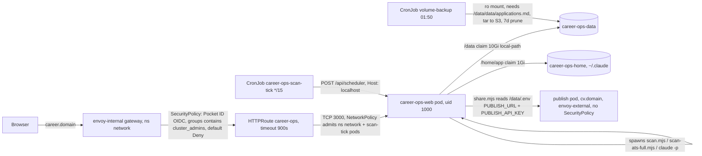

# Pre-migration audit of the cluster deployment

Written 2026-11-07 by the convergence coordinator before the data root moves into the `career-ops-data` claim. Three read-only explorers covered the home-cluster manifests, the fork's configuration surface and the local data root; one explainer reconciled them. Secret values are never recorded here.

Settled after the report was written: the web's `evaluate` run kind gets `TOOL_SCOPES.networkReadOnly` (`web/src/lib/claude-invocation.mjs:108-112`), so a pod evaluate has no Bash and `scan.extractor: cli` never runs `browser-extract.mjs` from the dashboard. JD text in a pod evaluate comes from WebFetch only. The setting still applies to CLI-driven agent runs. Measured.

---

# career-ops on the home cluster: architecture and pre-migration audit

Labels used below. **M** measured by me or an explorer reading the file or running a read-only command. **I** inferred from code or tool semantics. **G** guess.

## Overview

career-ops runs on the cluster as two apps in namespace `career-ops`. The dashboard pod serves the Next.js web and spawns every scan and `claude -p` run itself. The publish pod serves public CV share pages at `cv.<domain>`. The dashboard's user layer is an empty 10Gi `local-path` claim mounted at `/data`, which is why the Portals page shows the setup steps today. **M**

The data layout question is settled. With `CAREER_OPS_ROOT=/data`, copying `~/career-ops-data` 1:1 into `/data` puts the tracker at `/data/data/applications.md`, the exact path the backup CronJob guards. Nothing in the local tree needs re-nesting. **M**

The migration itself is small. About 5 MB of user files plus 62 MB of regenerable cache. The three things that bite are both Mac launchd jobs still firing every 15 minutes and every Sunday, a `/data/.env` that must be written by hand for the Shares page, and the fact that the Sunday full ATS sweep has no cluster equivalent until the operator creates a second scheduled job in the web UI. **M** for the first two, **I** for the third.

## Key Concepts

- **Data root.** `getCareerOpsRoot()` at `path-resolver.mjs:110-114` returns `CAREER_OPS_ROOT` when set. The web's `resolveDataRoot()` at `web/src/lib/core/data-root.mjs:48-51` follows the same order. The tracker is `{root}/data/applications.md` per `rawTrackerPath()` at `path-resolver.mjs:258-266`. **M**
- **External scheduler.** `CAREER_OPS_SCHEDULER=external` means a CronJob POSTs `/api/scheduler` every 15 minutes and the web pod runs `web/scripts/scheduled-jobs-runner.mjs`, which reads `data/scheduled-jobs.json` and spawns `scan.mjs` or `scan-ats-full.mjs`. Zero LLM tokens. **M**
- **Data-root `.env`.** The web server never loads it. Individual scripts do. The two that matter here are `publish/share.mjs` for `PUBLISH_URL` and `PUBLISH_API_KEY` at `publish/share.mjs:41-50`, and `lib/agent-cli.mjs:15-19` plus `web/src/lib/remembered-cli.mjs:20-21` for `CAREER_OPS_CLI`. Both check `process.env` first. **M**
- **Tool scopes.** `web/src/lib/claude-invocation.mjs:164-171` passes `--strict-mcp-config` with no `--mcp-config` for every non-writing run kind, so zero MCP servers load. Playwright MCP tools are never reachable from a pod run. **M**

## How It Works

**Request path.** Browser to `career.${SECRET_DOMAIN}` on `envoy-internal` only, since `public = false` in `cluster.toml`. The SecurityPolicy runs Pocket ID OIDC and allows only tokens whose `groups` claim contains `cluster_admins`, default Deny (`securitypolicy.yaml:40-48`). The HTTPRoute forwards to Service `career-ops-web:3000` with `timeouts.request: 900s` (`httproute.yaml:17-18`). The NetworkPolicy admits TCP 3000 from namespace `network` and from pods labelled `career-ops.io/role: scan-tick` (`networkpolicy.yaml:16-24`). The app itself has no login. `CAREER_OPS_WEB_ALLOWED_HOSTS=career.${SECRET_DOMAIN}` plus the gateway are the access control. **M**

**Scheduler tick.** `*/15 * * * *`, `concurrencyPolicy: Forbid`, curl image, `POST http://career-ops-web.career-ops.svc:3000/api/scheduler` with `Host: localhost`. Verified live on 2026-11-08 01:30Z. The runner then writes a temporary portals overlay under `{root}/data/tmp/` and runs the scanner with a 25-minute timeout, up to 3 attempts. The web Explore page spawns `scan-ats-full.mjs` directly at `web/src/lib/core/scan.ts:189-199` and reads only `scan.timeout_seconds` from the profile at `scan.ts:163-171`. **M**

**Publish hop.** The Shares page calls `POST /api/shares/pull`, which runs `node publish/share.mjs pull` through `runCoreCli` (`web/src/app/api/shares/pull/route.ts:10-12,29`). `core-cli.ts:37-39` spawns with the code root as cwd and `env: {...process.env}`. `share.mjs:293` resolves the root with `getCareerOpsRoot()` and `serviceConfig()` at `share.mjs:41-50` reads `PUBLISH_URL` and `PUBLISH_API_KEY` from env, else from `{root}/.env`, which is `/data/.env` in the pod. The web never reads the key itself. `web/src/lib/shares.ts:64-67` reads only `data/shares.json`. **M**

**Backup.** `volume-backup` CronJob at `50 1 * * *` mounts the claim read-only, runs `[ -f /data/data/applications.md ]` then `tar -czf ... -C /data .` in the app's own image for GNU tar, uploads to `s3/$BUCKET/volumes/career-ops/career-ops/`, prunes 7d (`backup-cronjob.yaml:8,35-38,68`). It fails until the tracker exists. The publish backup at `10 2 * * *` fails until the `shares` table has a row. VERIFY.md expects `KubeJobFailed` until then. **M**

## Where Things Live

| Thing | Path |
|---|---|
| Manifests | `~/dev/home-cluster/kubernetes/apps/career-ops/{career-ops,publish}/app/` rendered from `template/config/kubernetes/apps/career-ops/**/*.j2` |
| `[career_ops]` keys | `cluster.toml` (gitignored), model in `template/scripts/validate.py` |
| Deploy plan and lanes | `~/dev/home-cluster/.claude/plans/2026-11-07-career-ops-deploy/{plan.md,VERIFY.md,decisions.tsv}` |
| Plan contract | `~/dev/career-ops/docs/superpowers/plans/2026-11-06-reactive-resume-convergence.md:1345` |
| Image | `deploy/Dockerfile`, Playwright jammy base, `@anthropic-ai/claude-code@2.1.319`, tini; no TeX, no `gh` |
| Renovate | `~/dev/home-cluster/.renovaterc.json5` |
| Local data root | `~/career-ops-data`, resolved on the Mac through the plugin default or `CAREER_OPS_ROOT` in the scan script |
| Mac schedulers | `~/Library/LaunchAgents/io.career-ops.scheduled-scan.plist` and `io.career-ops.scan-full.plist`, both loaded now per `launchctl list` **M** |

## Settings audit

| Setting | Where | Value | Verdict | Note |
|---|---|---|---|---|
| `CAREER_OPS_ROOT` | web HelmRelease env `helmrelease.yaml:25` | `/data` | ok | Tracker lands at `/data/data/applications.md`. **M** |
| `CAREER_OPS_WEB_ALLOWED_HOSTS` | HelmRelease `:27` | `career.${SECRET_DOMAIN}` | ok | Binds 0.0.0.0. Probes and tick use `Host: localhost`, which the guard admits. **M** |
| `CAREER_OPS_SCHEDULER` / `_DESCRIPTION` | HelmRelease `:28-29` | `external` / CronJob text | ok | Verified `source: external`. **M** |
| `CAREER_OPS_CLI` | image ENV | `claude` | ok | Not in HelmRelease. Wins over any `.env` line in both readers. **M** |
| `CLAUDE_CODE_OAUTH_TOKEN` | Secret `career-ops-secret` via envFrom | `<secret>` | ok | One-year token. Renewal is `claude setup-token`, paste, `just configure`. **M** |
| `ANTHROPIC_API_KEY` | not set | absent | defaulted-fine | Setting it would bill per token over the subscription. **M** |
| `PUBLISH_URL`, `PUBLISH_API_KEY` | `/data/.env` on the claim | not written yet **I** | missing | Operator step after minting a key at `cv.<domain>/account`. Explorer did not `ls /data`. |
| Long-tail tuning (`CAREER_OPS_TIMEOUT_MS`, `_HTTP_*`, `_SCAN_*`, `_TRUST_PROXY_EGRESS`, `_PROFILE`, lock timeouts) | not set | defaults | defaulted-fine | None needed for this deployment. **M** |
| Image digest | HelmRelease `:22-23` | `career-ops-server:latest@sha256:ccd4e656…` | ok | Rebuilt on every push to fork `main`, Renovate automerges at any time. See Decisions. **M** |
| Replicas / strategy | HelmRelease | 1 / `Recreate` | ok | `lib/dir-lock.mjs` judges staleness by pid. Never scale to 2. **M** |
| Resources | HelmRelease | req 250m / 1Gi, limit 3Gi | defaulted-fine | No cpu limit. Untested under a real `claude -p` run. |
| PVC `career-ops-data` | persistence | 10Gi local-path RWO retain | ok | Migration target. Single node. **M** |
| PVC `career-ops-home` | persistence | 1Gi at `/home/app` | ok | Claude login state. **M** |
| SecurityPolicy | `securitypolicy.yaml` | Pocket ID, allow `groups` contains `cluster_admins`, default Deny | ok | Operator must be in `cluster_admins`. **M** |
| HTTPRoute parents | `httproute.yaml:8-9` | `envoy-internal` only | needs-decision | `public = false`. See Decisions. **M** |
| Tick CronJob | `scan-cronjob.yaml` | `*/15`, Forbid | ok | Runs nothing until `scheduled-jobs.json` has a job. **M** |
| Backup CronJobs | both `backup-cronjob.yaml` | 01:50 and 02:10 | ok, failing by design | Fail until tracker and first share exist. **M** |
| Publish env | publish HelmRelease | `PUBLISH_BASE_URL`, `POCKET_ID_*`, `PUBLISH_TRUSTED_PROXIES=10.42.0.0/16` | ok | Trusted-proxies CIDR is inert until the service matches CIDRs. Follow-up recorded. **M** |
| Publish secrets | `publish-secret` | `<secret>` x4 | ok | Rotating `PUBLISH_SECRET` breaks feedback links. **M** |
| `cv.md`, `modes/_profile.md`, `_custom.md`, `_brief.md` | user layer | personalized | ok | Differ from templates. **M** |
| `voice-dna.md` | user layer | byte-identical to template | needs-decision | Not flagged by `doctor`. See item 7. **M** |
| `config/profile.yml` `cv.output_format` | user layer | `html` | ok | `latex` would fail, see item 8. **M** |
| `config/profile.yml` `scan.extractor` | user layer | `cli` | ok | Correct for the pod, see item 3. **M** |
| `config/profile.yml` `spend_tier` | user layer | `standard` | defaulted-fine | Prompt-level only, the web passes no `--model`. **M** |
| `portals.yml` | user layer | 197 companies, 56 enabled, US-only `location_filter`, `experience_filter` label, `max_posting_age_days: 45` | ok | Seeds from the template only while the file is missing (`web/src/lib/portals-config.mjs:37-54`). **M** |
| `portals.yml` `scan_history.recheck_after_days` | user layer | absent | needs-decision | See item 10. **M** |
| `data/scheduled-jobs.json` | user layer | 1 active `portals` job, daily 12:00Z, tz America/New_York | needs-decision | No `full` engine job. See Decisions. **M** |
| `.env` on the Mac | user layer | one line `CAREER_OPS_CLI=claude` | drop | Inert in the pod. Do not copy. **M** |

## Settled items

1. **Layout.** `/data` + `data/applications.md` = `/data/data/applications.md`. `path-resolver.mjs:110-114` and `:258-266`, `data-root.mjs:48-51`, `backup-cronjob.yaml:35`. Copy 1:1. **M**
2. **`CAREER_OPS_CLI`.** Env wins in `lib/agent-cli.mjs:16` and `web/src/lib/remembered-cli.mjs:21`. The image sets `claude`. The Mac `.env` holds exactly `CAREER_OPS_CLI=claude` (grep count 1). It is harmless but redundant. Do not copy the Mac `.env`; write a fresh one on the claim with only the two `PUBLISH_*` lines. **M**
3. **`scan.extractor: cli`.** The web Explore scan and the scheduler tick never read it. It is read by `browser-extract.mjs:98-107` and honored by the agent modes at `modes/scan.md:138` and `modes/oferta.md:15` during `claude -p` runs. In the pod, `--strict-mcp-config` loads no MCP servers (`claude-invocation.mjs:164-169`) and no Playwright MCP is installed, so `mcp` would leave the agent with no browser at all. `cli` runs `node browser-extract.mjs`, which launches the bundled Playwright Chromium (`browser-extract.mjs:1390-1398`). `cli` is the right value. **M** Caveat under Open questions about Bash availability per run kind.
4. **`.env` for Shares.** `share.mjs:41-50` reads env then `{root}/.env`. The web spawns it with `process.env` and the pod's `CAREER_OPS_ROOT`, so `/data/.env` is the file. Write `PUBLISH_URL=https://cv.<domain>` and `PUBLISH_API_KEY=cops_…`. **M**
5. **Double scheduler.** `web/scripts/uninstall-scan-schedule.sh:5-18` boots out and deletes only `io.career-ops.scheduled-scan`. `install-scan-schedule.sh` has no `--uninstall` flag, so the plan contract's command does not exist. `io.career-ops.scan-full` is a hand-made plist pointing at `~/dev/job-search/tools/career-ops-scan.sh` and must be unloaded by hand with `launchctl bootout gui/$(id -u)/io.career-ops.scan-full` and the plist removed. Both are loaded right now. **M**
6. **File modes.** `scan-history.tsv` and `portal-health.tsv` are `0600`, owner uid 501 (`stat`, **M**). `kubectl cp` runs `tar` inside the container as uid 1000. A non-root tar cannot chown, so extracted files become owner 1000 with modes preserved, and `0600` owned by 1000 is readable by the pod. No problem on that path. **I** If the restore is done as root from a node shell or a root debug pod, ownership stays 501 and uid 1000 cannot read the two `0600` files. `fsGroup` does not fix that on a hostPath-backed `local-path` volume. **I** Cheapest guard is `chmod 644` on those two files before copying. Not tested.
7. **`voice-dna.md`.** Read by `modes/_shared.md:24` for all candidate-facing text, `modes/pdf.md:445` for the cover letter, `modes/cover.md:265`, `cv-voice.mjs:138` for the CV voice lint, `generate-latex.mjs:324`, and every `modes/*/_shared.md`. As a template it still supplies the anti-slop guardrail, only the personal voice section is generic. It never introduces facts, so there is no fabrication risk. Effect is cover letters and outreach sounding like the template author's defaults. **M**
8. **`cv.output_format`.** `html` is set. `latex` would route to `modes/latex.md` (`modes/pipeline.md:61`) and `resolveLatexEngine()` at `generate-latex.mjs:80-95` would find neither tectonic nor pdflatex, since the Dockerfile installs only tini and the Claude CLI (`deploy/Dockerfile:10-14`). Every other live profile key is usable in the pod. `github_evidence` is commented out and would need `gh`, which the image lacks. **M**
9. **Renovate.** Top-level `schedule: [\"every weekend\"]`. The career-ops rule matches `ghcr.io/jrmatherly/career-ops-server` and `career-ops-publish` by `matchPackageNames`, `matchUpdateTypes: [\"pinDigest\",\"digest\"]`, and overrides with `schedule: [\"at any time\"]`, `automerge: true`, `ignoreTests: true`, merged as a branch with no PR. A sibling `pinDigests: true` rule pins `latest` to its digest. The Tier 1 digest rule explicitly excludes these two images. Weekend-only is one change in that rule, `schedule: [\"at any time\"]` to `[\"every weekend\"]`, or dropping the line so the top-level schedule applies. Not edited. **M**
10. **Portals opt-ins.** All judgments. `scan_history.recheck_after_days: 30` is supported (`templates/portals.example.yml:26-32`, `scan.mjs:1749,1857`) and releases `added` and `skipped_expired` rows, so reposted roles resurface. Recommend. `trust_filter` (`:330-331`) adds little when every enabled board is an allowlisted ATS. Skip. `content_filter.by_title_keyword` (`:377-396`) can tighten a broad title keyword. Optional. Drop `LLMOps` and the two redundant keywords only for tidiness, no scan changes. `portal_prune_quiet_days` is read-only housekeeping via `stats.mjs --prune`. Skip.

## Before migration

1. **Confirm the claim is still empty and no `.env` exists.** `kubectl -n career-ops exec deploy/career-ops -- ls -la /data /data/data`. Read-only. Expected today, a `scheduled-jobs.json` with no jobs and a `.tick` marker. **M** for what the lane saw at 01:30Z.
2. **Mint the publish API key.** Sign in at `https://cv.<domain>/account` and create a key. The account must be in `PUBLISH_ALLOWED_EMAILS` and report `email_verified`. VERIFY.md:48.
3. **Decide the four decisions below** before copying, since two of them change files that are about to move.
4. **Unload BOTH Mac plists.** `web/scripts/uninstall-scan-schedule.sh` for `io.career-ops.scheduled-scan`, then by hand `launchctl bootout gui/$(id -u)/io.career-ops.scan-full && rm ~/Library/LaunchAgents/io.career-ops.scan-full.plist`. Both are loaded now and the first rewrites `scan-history.tsv`, `pipeline.md` and `scheduled-jobs.json` every 15 minutes. `uninstall-scan-schedule.sh:5-18`, `launchctl list` **M**.
5. **Fix modes on the two 0600 files.** `chmod 644 ~/career-ops-data/data/{scan-history.tsv,portal-health.tsv}`. Harmless on the Mac, removes the root-restore failure mode from item 6. **I**
6. **Do not scale to zero. Copy between ticks, `scheduled-jobs.json` last.** Judgment. The pod's `scheduled-jobs.json` has no jobs, so a tick during the copy does nothing. Scaling to zero would need a helper pod to reach the RWO claim and `kubectl cp` needs a running container with tar anyway. Copy everything except `data/scheduled-jobs.json` right after a quarter-hour mark, then copy that file. Flux would revert a `suspend` patch on the CronJob within its 1h interval, so suspending it is not worth it. **I**
7. **What to copy.** `cv.md`, `voice-dna.md`, `config/`, `portals.yml`, `modes/_profile.md`, `_custom.md`, `_brief.md`, `interview-prep/`, `reports/`, `jds/`, `output/`, and under `data/` the tracker, `status-log.tsv`, `follow-ups.md`, `pdf-index.tsv`, `pipeline.md`, `scan-history.tsv`, `scan-runs.tsv`, `portal-health.tsv`, `dead-boards.tsv`, `scheduled-jobs.json`. Optional `data/discard.log` and `data/cache/{ats-companies,provider-ids}`. **M** per the data-root explorer's inventory.
8. **What to leave.** `.env`, every `*.bak*`, `.ui/`, `.remember/`, `.career-ops-locks/`, `.career-ops-web/`, `data/cache/http` 59 MB, `data/tmp/`, the three logs, `scheduled-jobs.json.tick`, `batch/tracker-additions/merged/`. All regenerable or Mac-only. **M**
9. **Write `/data/.env` on the claim** with exactly two lines, `PUBLISH_URL=https://cv.<domain>` and `PUBLISH_API_KEY=<the key>`. No `CAREER_OPS_CLI` line. Mode 600 is fine, the pod owns it. `share.mjs:41-50`. **M**
10. **Verify in the pod.** `kubectl -n career-ops exec deploy/career-ops -- node doctor.mjs --json` should report `onboardingNeeded:false`, `cli_source` from env, and the `cli` extractor label from `doctor.mjs:1187`. Then `node verify-pipeline.mjs`. Both read-only.
11. **Expect the Portals page to flip.** `showPortalsSetup()` at `web/src/lib/portals-setup.mjs:11-15` hides the steps once the verify check reports the file configured. The page then lists the 56 enabled companies. **M**
12. **Expect the backup alerts to clear.** The career-ops backup passes on the next 01:50Z run once `/data/data/applications.md` exists. The publish backup keeps failing until the first share is published. **M**
13. **Mac afterwards.** Set `CAREER_OPS_ROOT` on the Mac to a scratch root or stop using the plugin against `~/career-ops-data`, per the plan contract. Two writers on two copies of the tracker would diverge silently. **I**

## Decisions the operator must make

1. **Weekend-only automerge for the two career-ops images?** Options are keep `at any time`, or restrict to `every weekend`. Every push to fork `main` rebuilds `latest`, Renovate moves the digest, and the `Recreate` rollout restarts the pod, which kills any `claude -p` run or scan in flight. Judgment, restrict to weekends unless the operator wants same-day fixes to land, in which case keep it and accept mid-run restarts. One-line change in `.renovaterc.json5`.
2. **`public` route?** `public = false` keeps `career.<domain>` on `envoy-internal`. Setting it true adds `envoy-external` as a second parent and relies on Pocket ID plus the `cluster_admins` group for access. Judgment, keep false until the OIDC sign-in lane is verified from a browser, then revisit if off-LAN access is wanted.
3. **`scan.extractor`.** Keep `cli`. In the pod `mcp` means no browser for agent runs. Judgment, no change. **M**
4. **Re-enable disabled companies?** 141 of 197 are disabled, 56 enabled, 48 scannable with a provider, 50 of 56 have produced a match. Judgment, do not bulk re-enable. Review disabled entries in batches after the first week of cluster scans, using `audit-portals.mjs` to see what each board actually holds.
5. **Recreate the Sunday full sweep in the cluster?** The Mac `scan-full` plist ran `scan-ats-full.mjs --since 7`. The one migrated job is engine `portals`. After step 4 above nothing runs the full sweep. Options are add a second scheduled job with engine `full` in the web UI, weekly, or drop it. Judgment, add it. `scheduled-jobs-runner.mjs` supports engine `full` with `ats` and `limitPerAts`. **M** for the runner, **I** that the existing job's `ats`/`limitPerAts` fields are ignored under engine `portals`.
6. **Personalize `voice-dna.md`?** Options are leave the template, or run a short session to fill the voice section. Judgment, low priority. Do it before the first cover letter from the cluster, not before migration.
7. **Keep `discard.log` and `data/cache/*`?** `discard.log` 188 KB feeds `discard-analytics.mjs` only. `cache/http` 59 MB is a regenerable HTTP cache. `ats-companies` and `provider-ids` total about 3 MB and save one first-run sweep. Judgment, copy `discard.log` and the two small caches, leave `cache/http`.
8. **`scan_history.recheck_after_days: 30`?** Judgment, add it. Without it a reposted role at the same URL is deduped forever.

## Gotchas

- The plan contract names `install-scan-schedule.sh --uninstall`. That flag does not exist. The real script is `web/scripts/uninstall-scan-schedule.sh`, and it does not know about `scan-full`. **M**
- Eight reports carry absolute Mac paths to an external Reactive Resume PDF. They dangle in the pod. Provenance only, the `output/` PDFs are separate. **M**
- `scheduled-jobs.json` carries `nextRunAt 2026-11-08T12:00Z`. Once copied, the first pod tick after that time runs the daily job. If the copy lands after 12:00Z the job runs on the next tick. **M**
- A `.env` line is read by scripts but not by the web server or by `claude -p`. Anything that must reach a spawned `claude` goes in pod env. **M**
- `defaultAction: Deny` with one group rule means a Pocket ID account outside `cluster_admins` gets 403 even if it is the owner. **M**
- The Mac plugin copy is `1.39.0`, 392 commits behind the fork's `main`, while the image is built from `main`. Behavior differs between the two until the Mac stops being a writer. **M**
- `kubectl cp` needs `tar` in the container. GNU tar is present from the jammy base, which the backup CronJob already relies on. **M**

## Open questions

- Does the web's `evaluate` run kind allow Bash, so `node browser-extract.mjs` can actually run under `scan.extractor: cli`? The config explorer said `pdf` and `evaluate` get no Bash. If true, a pod evaluate run has no browser path at all and JD text comes only from WebFetch or `fetch-jd.mjs`. Settle with `grep -n \"evaluate\" web/src/lib/claude-invocation.mjs` and read `capabilitiesFor`.
- Does `/data/.env` already exist on the claim? `kubectl -n career-ops exec deploy/career-ops -- ls -la /data`.
- Is the pod's `claude` logged in through the OAuth token alone, with `~/.claude` empty on `career-ops-home`? Lanes 5 and 6 in VERIFY.md are unrun. A single evaluate from the web settles it.
- Does `fsGroup: 1000` change ownership of pre-existing files on this `local-path` volume? `kubectl exec ... stat -c '%u %a' /data/data/scan-history.tsv` after the copy.
- Node floor on the image. `kubectl exec deploy/career-ops -- node --version`.
- Whether the pod's 3Gi memory limit holds under a `claude -p` run plus Playwright Chromium. Watch `kubectl top pod` during lane 5.

Skipped. I did not run any kubectl command, did not open the live cluster, did not read `cv.md` or tracker contents, and did not test tar ownership semantics. The `0600` ownership reasoning and the between-ticks copy advice are inference. Risk to know. If the operator copies as root from the node, the two `0600` files become unreadable to the pod and scans fail until a `chmod`.
</agent-message>"

EVALUATE: Is this prompt clear enough to execute, or does it need enrichment?

PROCEED IMMEDIATELY if:
- Detailed/specific OR you have sufficient context OR can infer intent

ONLY USE SKILL if genuinely vague (e.g., "fix the bug" with no context):
- If vague:
1. First, preface with brief note: "Hey! The Prompt Improver Hook flagged your prompt as a bit vague because [specific reason: ambiguous scope/missing context/unclear target/etc]."
2. Then use the prompt-improver skill to research and generate clarifying questions
- The skill will guide you through research, question generation, and execution
- Trust user intent by default. Check conversation history before using the skill.

If clear, proceed with the original request. If vague, invoke the skill.

If the response will be a substantial deliverable (report, review, summary, comparison, analysis): make it human-parsable - lead with the conclusion, prefer short sections, tables, and bullets over walls of prose, define jargon on first use, and keep it terse.
If this is a quick back-and-forth, ignore this guidance.

If carrying out this request means making a decision that is genuinely the user's (an ambiguous fork, a real tradeoff, missing requirements): ask with the AskUserQuestion tool rather than guessing or burying the choice in prose - concrete options with their tradeoffs let the user react and think critically.
When you lack the context to frame those options well, research and explore first so the questions are specific and grounded, not generic.
For minor or reversible choices, pick a sensible default, note it, and proceed - only interrupt for decisions that genuinely need the user.

Before starting, judge whether this task is complex, multi-step, ambiguous, or architectural enough to benefit from a plan reviewed before any code is written - if so, enter plan mode first to align on the approach.
If it is straightforward or a single clear step, just proceed - do not plan trivial work.
